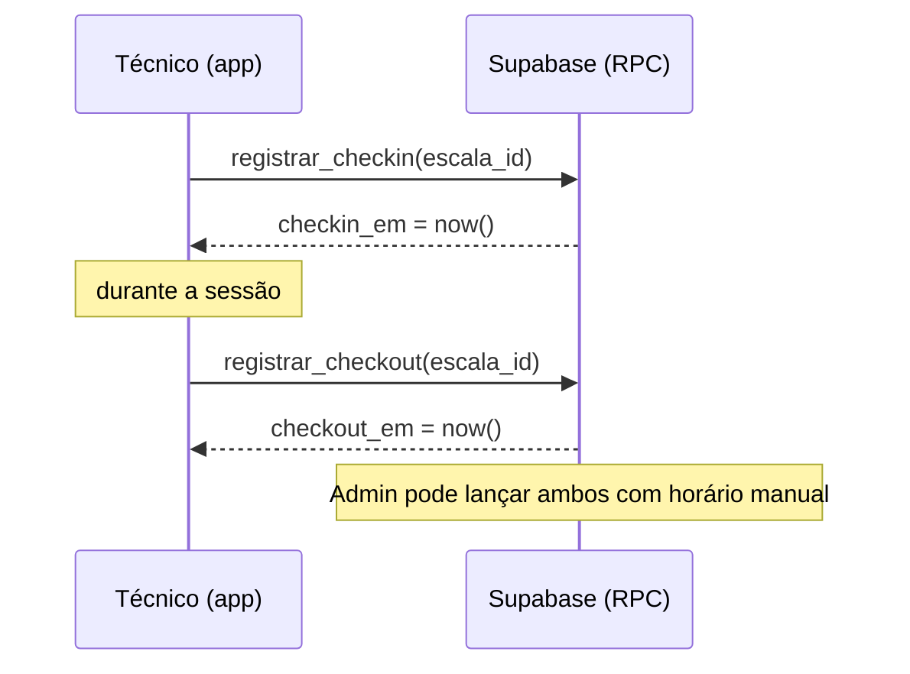

# SDD — Software Design Document
# Escala Sessão TRT20

> **Versão:** 2.0
> **Data:** 2026-10-25

---

## 1. Stack

React 19 · TypeScript 5.8 · Vite 6 · TailwindCSS 4 · React Router 7 · lucide-react · react-hot-toast · react-datepicker · Supabase (Postgres, Auth, Storage, Edge Functions em Deno) · vite-plugin-pwa · Firebase FCM (opcional).

## 2. Estrutura

```
src/
├── App.tsx                 # Rotas + guards (ProtectedRoute, AdminRoute)
├── constants.ts            # Sessões, funções, status, template padrão
├── types.ts
├── pages/admin/            # Dashboard, ManageScales, MembersList, AddMember,
│                           # ManageNotices, ManageAbsences, ManageSwaps, AdminMissedScales
├── pages/member/           # MemberDashboard, MemberGeneralSchedule, MemberSwaps,
│                           # MemberNotices, MemberAbsences, MemberProfile
├── layouts/                # AdminLayout (sidebar), MemberLayout (tab bar)
├── components/             # CustomDatePicker, IosInstallBanner
├── services/
│   ├── supabaseClient.ts   # ÚNICO cliente Supabase
│   ├── presencaService.ts  # registrarCheckin / registrarCheckout (RPC)
│   ├── ausenciasService.ts
│   ├── whatsappService.ts
│   └── fcmService.ts
└── utils/                  # date.ts (getLocalDateStr, formatHora, ...), greeting.ts

supabase/
├── sql/01_schema.sql       # Schema completo + RLS + RPCs + seed
├── sql/02_storage.sql      # Bucket fotos-membros
├── sql/03_primeiro_admin.sql
├── sql/04_cron_lembretes.sql
└── functions/              # _shared/auth.ts, create-member, update-member, delete-member,
                            # send-whatsapp, send-session-reminders, send-push-notification
```

## 3. Banco de Dados

### membros
`id` (PK, FK auth.users CASCADE), `nome`, `email` (UNIQUE), `celular_whatsapp`, `foto_url`, `is_admin`, `ativo`, `created_at`.

### escalas — um slot (função) por sessão
| Coluna | Tipo | Observação |
|---|---|---|
| `data` | DATE | |
| `hora_inicio` | TIME | obrigatório |
| `lembrete_enviado_em` | TIMESTAMPTZ | preenchido por `send-session-reminders` |
| `tipo_sessao` | VARCHAR(50) | CHECK `'1ª Turma' \| '2ª Turma' \| 'Pleno'` |
| `funcao` | VARCHAR(100) | default `'Suporte PJe'` |
| `membro_original_id` | UUID | FK RESTRICT |
| `membro_substituto_id` | UUID | FK SET NULL |
| `justificativa_troca`, `status_substituicao` | | permutas |
| `compareceu` | BOOLEAN | NULL pendente · TRUE presente · FALSE falta |
| `checkin_em`, `checkin_por` | TIMESTAMPTZ, UUID | gravados por `registrar_checkin` |
| `checkout_em`, `checkout_por` | TIMESTAMPTZ, UUID | gravados por `registrar_checkout` |
| `publicada` | BOOLEAN | default TRUE |

Restrições: `UNIQUE (data, tipo_sessao, funcao)`; `checkout_em >= checkin_em`.

### Demais tabelas
`ausencias_programadas`, `avisos`, `membro_fcm_tokens`, `sessao_mensagens` (template por `tipo_sessao`).

## 4. Funções no banco

| Função | Descrição |
|---|---|
| `is_admin()` | SECURITY DEFINER; usada nas policies |
| `membro_efetivo(escala)` | substituto (se permuta aceita) ou titular |
| `registrar_checkin(p_escala_id, p_horario default null)` | membro: só a própria escala, no dia (America/Maceio), uma vez, sem horário manual. Admin: qualquer escala e horário |
| `registrar_checkout(p_escala_id, p_horario default null)` | exige check-in; mesmas regras; horário ≥ check-in |
| `proteger_escala()` (trigger BEFORE UPDATE) | não-admin não altera data/sessão/função/titular/publicada nem campos de presença fora das RPCs (flag `app.presenca_rpc`) |

## 5. RLS (todas as tabelas com RLS, papel `authenticated`)

| Tabela | SELECT | INSERT | UPDATE | DELETE |
|---|---|---|---|---|
| membros | todos | admin | admin | admin |
| escalas | todos | admin | admin, titular, substituto ou em troca | admin |
| ausencias_programadas | todos | próprio/admin | — | próprio/admin |
| avisos | próprio/admin | admin | próprio/admin | admin |
| membro_fcm_tokens | próprio | próprio | próprio | próprio |
| sessao_mensagens | todos | admin | admin | admin |

Edge Functions usam `service_role` e validam o chamador (`_shared/auth.ts`):
- `create-member`, `delete-member`: somente admin (delete bloqueado se houver escalas ou se for o próprio admin).
- `update-member`: admin edita tudo; membro edita só o próprio telefone e foto.
- `send-session-reminders`: somente com o header `x-cron-secret` = `CRON_SECRET`. O job `lembrete-sessoes-20min` (pg_cron, a cada minuto) só chama a função quando há sessão de hoje começando nos próximos 20 min sem lembrete; a função marca `lembrete_enviado_em` antes de enviar (evita duplicidade).
- `sync-google-calendar`: espelha a escala publicada numa agenda compartilhada do Google (um evento por sessão, id fixo derivado de data + sessão, início = fim = `hora_inicio`). Chamada (a) pelos triggers `trg_google_agenda_*` em `escalas` (`06_google_agenda.sql`, via `pg_net`, header `x-cron-secret`) quando escalas publicadas são inseridas, excluídas ou mudam de data/horário/sessão/função/técnico/permuta/publicação; e (b) pela tela Admin → Google Agenda (somente admin) para salvar/testar/desconectar a conexão e sincronizar um mês. A chave da Service Account e o ID da agenda ficam em `google_agenda_config` (RLS sem policies: só `service_role`).

## 6. Fluxo de Check-in / Check-out



## 7. Padrões

- Estado local por página (`useState`/`useEffect`), sem store global.
- Datas `DATE` como `YYYY-MM-DD`; exibir com `new Date(d + 'T12:00:00')`; "hoje" com `getLocalDateStr()`.
- Erros via `react-hot-toast` ou toast local; mensagens das RPCs são exibidas ao usuário.

## 8. Variáveis de Ambiente

`VITE_SUPABASE_URL`, `VITE_SUPABASE_ANON_KEY` (obrigatórias) e `VITE_FIREBASE_*` (opcionais). Ver `.env.example`.

## 9. Scripts

`npm run dev` (porta 3000) · `npm run build` · `npm run preview` · `npm run lint` (tsc).
